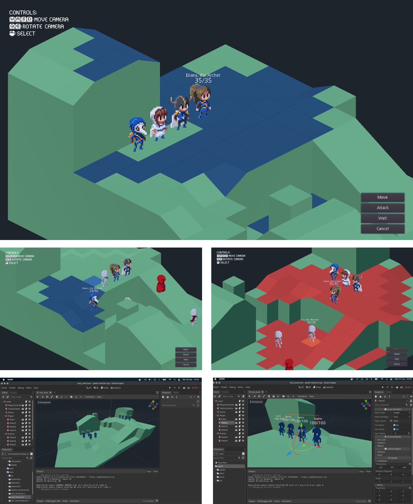

[>>> Para começar, consulte a Wiki do projeto <<<](https://github.com/ramaureirac/godot-tactical-rpg/wiki)

# Sobre

Um modelo simples para criar jogos de RPG tático com a [Godot Engine 4](https://godotengine.org/). Este projeto é uma demonstração feita por hobby, não um framework completo nem um jogo finalizado. Sinta-se à vontade para usá-lo como base para seu próprio jogo.

O projeto foi atualizado e validado com a Godot 4.7.2. Versões anteriores da engine não são mais compatíveis.

- [Demonstração das funcionalidades no YouTube](https://youtu.be/lJKWlLwYDZY)
- [Outra demonstração, por Open Source Games](https://www.youtube.com/watch?v=-AY6KEdX_3E)
- Para projetos 2D, veja [GDQuest](https://github.com/GDQuest/godot-2d-tactical-rpg-movement) ou [TBS_GoDot](https://github.com/ja-brouil/TBS_GoDot).
- Para um tutorial de busca de caminhos, veja [GameDevArts](https://www.youtube.com/watch?v=fYtwZdQTP5A) (em inglês).

# Funcionalidades

- Combate por turnos e movimentação em grade.
- Cada personagem pode se mover e atacar.
- IA inimiga básica.
- Câmera com deslocamento, visão livre, zoom e rotação.
- Controles por mouse, teclado ou gamepad, com distância de afastamento configurável.
- Reconhecimento de mapas criados no Blender. Consulte o [tutorial de criação de mapas](./docs/tutorials/how-to-create-maps/README.md).
- Documentação integrada ao editor da Godot.
- Registro de depuração ativável, com saída no painel de execução e opção de desativação em `TacticsConfig`.

### Refatoração da versão 4.3
[Diagrama geral da estrutura](https://github.com/user-attachments/assets/65bb6862-6e84-4149-af5a-047a04f413eb)

- A estrutura do projeto foi organizada para facilitar a reutilização e expansão:
  - `Models`: parâmetros e lógica centralizados.
  - `Modules`: unidades reutilizáveis baseadas em nós da Godot.
  - Diretório dedicado aos mapas.
- O código segue as [convenções oficiais de estilo do GDScript](https://docs.godotengine.org/en/stable/tutorials/scripting/gdscript/gdscript_styleguide.html#one-statement-per-line).
- Foram feitas pequenas otimizações de desempenho.

# Prévia

# Contribuição

Contribuições e relatos de problemas são bem-vindos. Para manter o projeto simples e alinhado à proposta original, sugerimos abrir uma issue para discutir uma ideia antes de enviar um pull request. Para começar com uma tarefa pequena, procure por issues com a etiqueta `Good First Issue`.

# Agradecimentos

- GDQuest
- Tiny Legions
- Miziziziz
- TutsByKai
- AdamCYounis
- Comunidade da Godot, fóruns e Stack Overflow
- Grass shaders and art assets by Dylearn (MIT and CC BY 4.0; see [license](./assets/environment/grass/LICENSE.txt)). The sky environment was created for this project.
